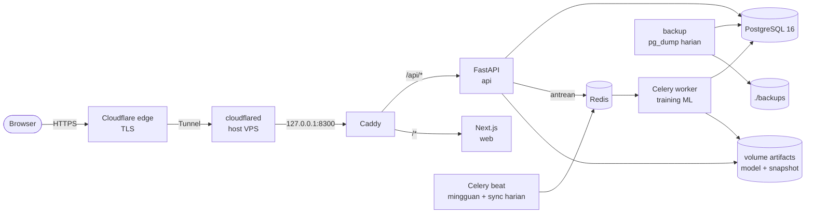

# Platform Monitoring & Prediksi Kualitas Udara ISPU DKI Jakarta

Aplikasi web untuk memantau dan memprediksi kualitas udara harian (Indeks Standar Pencemar Udara)
dari 5 stasiun SPKU DKI Jakarta, Januari 2024 – November 2025. Sumber data: DLH Provinsi DKI
Jakarta via [Satu Data Jakarta](https://satudata.jakarta.go.id/open-data/detail?kategori=dataset&page_url=data-indeks-standar-pencemar-udara-ispu-di-provinsi-dki-jakarta).
Dibangun dari tugas kuliah "Dari Data Menjadi Solusi AI" (model awal di Orange Data Mining).

- **URL:** `https://udara.example.com` (publik, read-only) · admin di `/admin`
- **Rencana & keputusan desain:** [`docs/PLAN.md`](docs/PLAN.md) · **Screenshot:** [`docs/screenshots/`](docs/screenshots/)

> Nilai polutan di dataset ini adalah **nilai indeks ISPU per polutan**, bukan konsentrasi µg/m³.
> `max` = nilai tertinggi dari 6 polutan dan `kategori` ditentukan dari `max`
> (0–50 BAIK, 51–100 SEDANG, 101–200 TIDAK SEHAT, 201–300 SANGAT TIDAK SEHAT, >300 BERBAHAYA).

## Arsitektur



| Folder | Isi |
|---|---|
| `backend/` | FastAPI + Pydantic v2, SQLAlchemy 2, Alembic, ingest, auth, Celery, tes pytest |
| `ml/` | Paket `ispu_ml`: klasifikasi, forecasting, metrik, snapshot data |
| `frontend/` | Next.js 16 (App Router) + TS, Tailwind 4, komponen gaya shadcn/ui, TanStack Query, ECharts 6, tes Playwright |
| `deploy/` | `compose.yaml`, `Caddyfile`, `build.sh`, `backup.sh`, `restore.sh`, `cloudflare-publish.sh` |
| root | Data asli (CSV/XLSX, tidak pernah diubah; checksum di `docs/original-files.sha256`) dan dokumen tugas |

Service compose (`name: ispu`): `postgres`, `redis`, `api`, `worker`, `beat`, `web`, `caddy`, `backup`.
Semua punya healthcheck. Hanya Caddy yang dipublikasikan, dan hanya di `127.0.0.1:8300`; VPS ada di
balik NAT sehingga akses publik lewat Cloudflare Tunnel (HTTPS di edge Cloudflare).

## Menjalankan lokal

```sh
cp deploy/.env.example deploy/.env        # isi nilainya
chmod 600 deploy/.env
deploy/build.sh                            # build ispu-backend + ispu-web (lihat catatan jaringan di skrip)
docker compose -f deploy/compose.yaml up -d --no-build
docker compose -f deploy/compose.yaml ps   # tunggu semua healthy
# buka http://127.0.0.1:8300
```

Start pertama: `api` menjalankan migrasi Alembic lalu seed dari CSV bersih (3.131 baris) dan hasil
testing Orange (626 baris, sebagai baseline). Worker otomatis melatih model pertama (~1,5 menit).
Dokumentasi API: `http://127.0.0.1:8300/api/docs`.

Frontend dev dengan hot reload: `cd frontend && npm ci && API_PROXY=http://127.0.0.1:8300 npm run dev`.
Tipe TypeScript API dibuat dari OpenAPI: `npm run gen:api` (butuh stack berjalan).

## Deploy ke VPS

1. Jalankan stack seperti di atas (sudah berjalan di VPS ini, repo `~/Kuliah/Dataset Training AI`).
2. Publikasikan hostname lewat tunnel yang sudah ada (idempoten, menyimpan konfigurasi tunnel lama ke `backups/`):
   ```sh
   deploy/cloudflare-publish.sh     # ingress udara.example.com -> http://localhost:8300 + CNAME proxied
   curl -sI https://udara.example.com/ | head -1
   ```
   `udara.example.com` tidak tercakup aplikasi Cloudflare Access mana pun, jadi dashboard publik;
   halaman admin dilindungi login aplikasi.
3. Firewall tidak perlu diubah: tidak ada port baru yang dibuka ke internet.
4. Update: `git pull && deploy/build.sh && docker compose -f deploy/compose.yaml up -d --no-build`.

## Upload data

Login di `/admin` → **Upload data CSV**. Diterima format mentah Satu Data (BOM ganda, nama stasiun
tidak seragam, `N/A`) maupun format bersih. Pipeline: validasi skema → normalisasi stasiun (kode
`DKIn`; stasiun baru otomatis dibuat) → baris `N/A`/tanggal tidak valid/`max` tidak cocok ditolak
beserta alasannya → hitung `kategori_ispu` dari `max` → flag `label_inconsistent` (tidak dihapus) →
upsert per (tanggal, stasiun). Laporan: baris baru, di-update, tidak berubah, ditolak (+alasan per baris).
Batas: `.csv`, UTF-8, maks 5 MB. Jika ada data berubah, retraining diantrekan otomatis.

CLI alternatif: `docker compose -f deploy/compose.yaml exec api python -m app.cli ingest /seed/raw.csv`.

**Sinkronisasi Satu Data (opsional, mati secara default):** `SATUDATA_SYNC=true` di `deploy/.env` →
worker mengunduh ekspor CSV resmi tiap hari 03.00 WIB (URL resource yang dicantumkan data.go.id),
ingest bila isinya berubah, lalu retraining. Per 26 Okt 2026 file portal identik dengan CSV mentah di repo,
jadi menyalakannya akan menambah 1 baris SANGAT TIDAK SEHAT (2024-02-14 DKI3) yang tidak ada di CSV bersih.

## Retraining & rollback

- **Otomatis:** setelah ingest yang mengubah data, dan cadangan mingguan Minggu 02.00 WIB (Celery beat).
  Dilewati bila snapshot data + konfigurasi sama dengan champion.
- **Manual:** tombol **Latih ulang sekarang** di admin, atau
  `docker compose -f deploy/compose.yaml exec worker python -m app.cli train`.
- **Champion/challenger:** tiap versi menyimpan artifact `eval` (dilatih sampai batas holdout) dan
  `serve` (dilatih ulang pada semua data). Champion diskor ulang dengan artifact `eval`-nya pada holdout
  yang sama dengan challenger; challenger hanya dipromosikan bila macro F1 (klasifikasi) ≥ champion
  atau MAE PM2.5 rata-rata (forecast) ≤ champion. Keputusan + alasan tersimpan di `training_runs`.
- **Rollback:** tombol **Rollback** di tabel registry (konfirmasi dua langkah), atau
  `app.cli rollback <model_version_id>`. Forecast dibuat ulang dari versi tersebut.
- **Reproducible:** seed 42 di semua model, snapshot data `artifacts/snapshots/<sha256>.csv.gz` per run.

## Penjelasan model

**Klasifikasi** (melanjutkan tugas kuliah): kategori dari 6 polutan di hari yang sama. Kandidat:
Decision Tree, Random Forest, kNN (k=5, distandarkan), LightGBM; pembanding: **aturan ambang ISPU**.
Evaluasi pada holdout waktu (20% tanggal terakhir) dan split 80:20 stratified (paritas Orange).
Karena kategori ditentukan langsung dari `max`, aturan ambang hampir selalu benar dan **tidak ada model ML
yang mengalahkannya**. Ini temuan, bukan kegagalan: nilai ML sebenarnya ada di forecasting.

**Forecasting** H+1..H+7 per stasiun: satu LightGBM per (polutan, horizon), pooled lintas stasiun.
Fitur: lag 0/1/2/6/13 hari, rolling mean 3/7/14, hari dalam minggu & bulan tanggal target, stasiun.
Celah data tetap NaN (tidak diisi). Kategori turunan = ambang ISPU dari max 6 prediksi. Interval
10–90% = kuantil residual holdout. Validasi: holdout waktu + rolling-origin backtest 5 fold (bukan split acak).
Baseline: persistence (nilai kemarin) dan seasonal naive (7 hari lalu).

Hasil champion v1 (holdout 14 Jul – 30 Nov 2025):

| Metode | MAE PM2.5 rata-rata | Akurasi kategori rata-rata |
|---|---|---|
| LightGBM | 13,74 | 82,5% |
| Persistence | 13,93 | 77,2% |
| Seasonal naive | 15,29 | 74,7% |

LightGBM unggul rata-rata, tetapi pada H+5–H+7 MAE PM2.5-nya sedikit di atas salah satu baseline;
halaman Evaluasi menampilkan ini apa adanya. Forecast dihitung dari **tanggal data terakhir**
(saat ini 30 Nov 2025), bukan dari hari ini, sampai ada data baru.

**Baseline Orange** (626 data uji, dihitung ulang dari database): RF 97,60% (611), DT 98,24% (615),
kNN 91,85% (575); weighted F1 0,9761 / 0,9825 / 0,9155. 21 baris DKI1 Desember 2024 berlabel tidak
sesuai ambang dan ditandai `label_inconsistent`.

## Backup & restore

- Container `backup`: `pg_dump -Fc` saat start lalu tiap hari 01.00 WIB ke `./backups/`, simpan 14 file
  terbaru (`BACKUP_HOUR`, `BACKUP_KEEP`). Healthcheck gagal bila tidak ada backup < 26 jam.
- Uji restore (ke database terpisah `ispu_restore_check`, produksi tidak tersentuh):
  ```sh
  deploy/restore.sh backups/ispu-YYYYmmdd-HHMMSS.dump
  ```
- Restore ke produksi (menimpa; minta mengetik nama database; api/worker/beat dihentikan sementara):
  ```sh
  deploy/restore.sh backups/ispu-YYYYmmdd-HHMMSS.dump ispu
  ```
- Volume `artifacts` (model) tidak ikut pg_dump; bila hilang, jalankan `app.cli train` untuk melatih ulang.

## Tes & kualitas

```sh
# backend: ruff + pytest (DB terpisah ispu_test di server PostgreSQL yang sama)
cd deploy && docker compose run --rm --no-deps --user "$(id -u):$(id -g)" -e RUN_MIGRATIONS=0 \
  -v "$PWD/../backend:/app" -v "$PWD/../ml:/ml" api \
  sh -c "ruff check . /ml && ruff format --check . /ml && pytest -q -p no:cacheprovider"

# frontend: typecheck, lint, format
cd frontend && npm run typecheck && npm run lint && npm run format

# e2e + audit WCAG AA (axe) di desktop & mobile 375px, light & dark
docker run --rm --network host <kredensial admin e2e> \
  -e E2E_CLEAN_CSV=/data/clean.csv -v "$PWD/frontend:/w" \
  -v "$PWD/Dataset_ISPU_DKI_Jakarta_2024_2025_Clean.csv:/data/clean.csv:ro" -w /w \
  mcr.microsoft.com/playwright:v1.64.1-noble npx playwright test
# terhadap domain: tambahkan -e BASE_URL=https://udara.example.com
```

Tes e2e admin meng-upload ulang CSV bersih (0 perubahan), jadi aman dijalankan ke produksi.

## Catatan operasional

- `deploy/build.sh` memakai `docker build --network host` karena jaringan bridge BuildKit di VPS ini
  sangat lambat ke PyPI/npm; Dockerfile backend memakai cache pip BuildKit.
- Data terakhir 30 Nov 2025; dashboard selalu menampilkan rentang data, tidak menyebut data "real-time".
